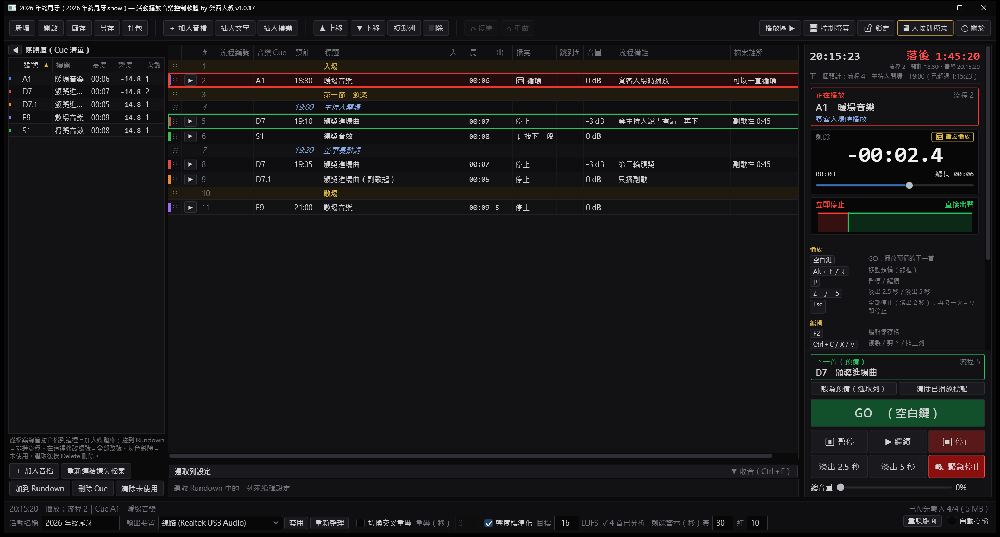
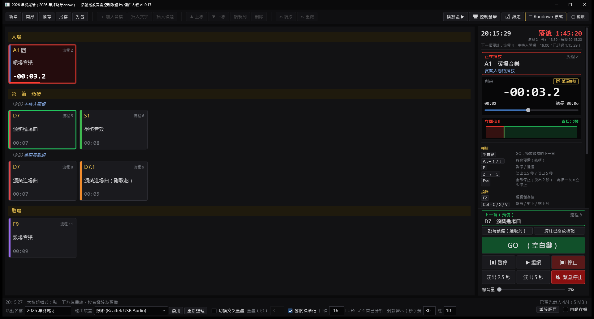
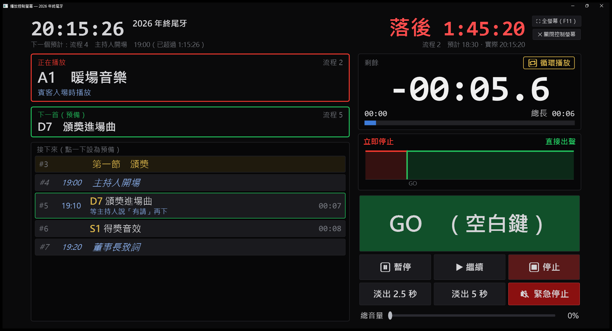

# 活動播放音樂控制軟體（JCT EventMusicPlayer）

**by 傑西大叔**

給活動、尾牙、記者會、發表會、婚禮等舞台現場使用的 Windows 音樂播放控制軟體。
依照活動流程（Rundown）排好音樂，現場只要按 **GO**（空白鍵）就照順序播放，淡入淡出、交叉重疊、連續播放、響度一致都自動處理。

## 下載

到 **[Releases](../../releases/latest)** 下載最新版的 `JCT-EventMusicPlayer.exe`。

- **單一執行檔，不需要安裝**：.NET 執行環境已經包在裡面，下載後直接執行
- 可以放在隨身碟裡帶到現場的電腦使用

### 系統需求

- Windows 10／11（64 位元）
- 音效卡、USB 音訊介面、HDMI 等 Windows 認得的輸出裝置都可以
- mp3、mp4、m4a、aac、wma、flac 由 Windows 內建的 Media Foundation 解碼。一般版本的 Windows 都有；**Windows N／KN 版**需要另外安裝微軟的「媒體功能套件（Media Feature Pack）」，否則只能播放 wav、ogg、aiff

### 第一次執行看到「Windows 已保護您的電腦」

這是 Windows SmartScreen 對沒有付費程式碼簽章的軟體的一般警告。請按 **「其他資訊」→「仍要執行」**，之後就不會再出現。

## 主要功能

### 流程編排（Rundown）
- 音樂列、純文字列（例：主持人開場）、分段標題，照活動流程排列
- **流程編號**（每一列）和**音樂 Cue 編號**分開：同一首歌可以在流程中出現很多次，同編號的設定自動連動；改成新編號（例：D7 → D7.1）就分出一個獨立的 Cue
- 每列可以填**預計時間**與**流程備註**；拖曳 ⋮⋮ 排序、複製貼上整列、復原／重做
- 每首可設定起播點／結束點、音量、淡入、淡出、顏色標籤、播完動作（停止、接下一段、循環、播完跳到指定的列）

### 現場播放
- **GO 播放預備的下一首**（綠框），正在播放的列紅框閃爍
- 切換時自動淡出淡入；可以開啟**切換交叉重疊**，兩首交叉淡化
- **連續播放**：「接下一段」串起來的歌顯示「連續 2／4」、整串剩餘時間與預計結束時間
- 剩餘時間大字倒數，快結束時變黃、變紅閃爍
- **超前／落後**：依預計時間顯示目前進度
- 暫停、停止、淡出 2.5 秒／5 秒、**緊急停止**
- **大按鈕模式**：每首一個大方塊，點一下就播放，適合觸控螢幕

### 播放控制螢幕
- 第二個螢幕專用的 1920×1080 控制畫面：正在播放、下一首、接下來的流程、剩餘時間、切換預告、GO
- 有第二螢幕時自動開在第二螢幕，F11 全螢幕

### 響度標準化
- 自動量測每首歌的響度（ITU-R BS.1770），播放時補償到目標響度（預設 −16 LUFS），每首聽起來一樣大聲
- 不改你手動調的音量；拉大後會破音的歌自動用壓縮器＋限幅器保護峰值
- 每首可以排除（例：刻意要比較小聲的環境音、要保留衝擊感的雷聲）

### 現場安全
- 開啟專案時檢查所有音檔是否存在，找不到的可以指定資料夾自動重新連結
- **預先載入**：音檔讀進記憶體，隨身碟被拔掉也能照常播放
- 自動存檔、當機復原、**演出鎖定**（鎖住編輯只能播放）
- 輸出裝置被拔掉或改變時閃紅提示
- 執行中不會自動休眠、不會關閉螢幕
- **專案打包**：把專案和所有音檔複製到一個資料夾，方便帶到現場的電腦
- 支援觸控螢幕、Windows 顯示比例 100%～150%、深色介面（暗處的舞台控台不刺眼）

## 快速上手

1. 按 **「＋ 加入音檔」**，或從檔案總管把音檔拖進來
2. 用「插入文字」「插入標題」補上流程，拖曳 ⋮⋮ 調整順序
3. 選取一列，在下方的「選取列設定」調整淡入淡出、音量、播完動作
4. 在狀態列選擇**輸出裝置**
5. 現場按 **GO**（空白鍵）照順序播放；按 Ctrl＋L 鎖定，避免誤改

## 快捷鍵

| 按鍵 | 功能 |
|---|---|
| 空白鍵 | GO：播放預備的下一首 |
| Alt＋↑／↓ | 移動預備（綠框） |
| P | 暫停／繼續 |
| 2／5 | 淡出 2.5 秒／淡出 5 秒 |
| Esc | 全部停止（淡出 2 秒）；再按一次＝立即停止 |
| Ctrl＋L | 演出鎖定／解除 |
| Ctrl＋M | 切換 Rundown／大按鈕模式 |
| Ctrl＋Shift＋P | 開啟／關閉播放控制螢幕 |
| Ctrl＋B／Ctrl＋E | 隱藏媒體庫／收合下方編輯區 |
| Ctrl＋Shift＋B | 隱藏右側播放區 |
| Ctrl＋C／X／V、Ctrl＋D | 複製／剪下／貼上整列、複製一列 |
| Ctrl＋↑／↓ | 移動列 |
| Ctrl＋Z／Y | 復原／重做 |
| Ctrl＋S | 儲存 |
| Ctrl＋滾輪 | 縮放 Rundown |

## 資料存放位置

- **專案檔**（`.show`）：存在你選的位置，音檔放在專案資料夾內時會用相對路徑
- **這台電腦的設定**：`%LocalAppData%\EventPlayer`（視窗版面、響度量測結果、當機復原檔）。軟體的「ⓘ 關於」可以直接開啟這個資料夾

## 使用條款

- 免費使用，個人與商業活動都可以
- 歡迎分享本頁的下載連結
- 禁止轉售，也禁止修改後以自己的名義散布
- 本軟體依現狀提供，不提供任何保固；正式演出前請先在現場的電腦與音響上測試

## 第三方元件

本軟體使用 NAudio、NVorbis、CommunityToolkit.Mvvm、.NET 等開放原始碼元件（MIT 授權），授權全文見 [THIRD-PARTY-NOTICES.txt](THIRD-PARTY-NOTICES.txt)，軟體的「ⓘ 關於」裡也看得到。
